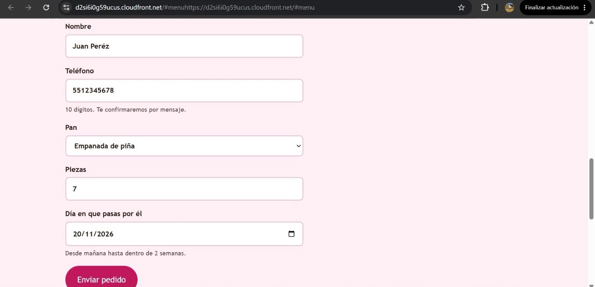
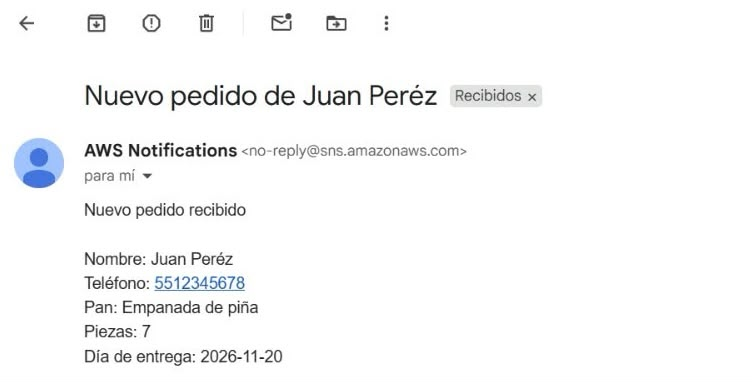
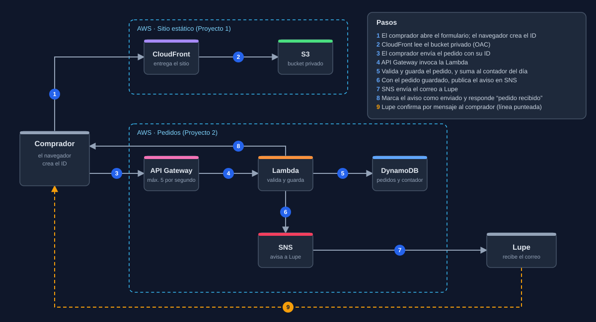
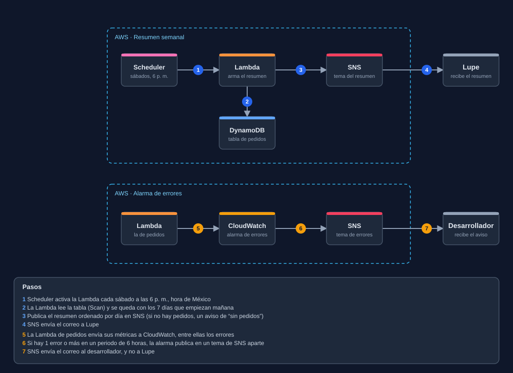

# Pedidos para Panadería Doña Lupe: formulario sin servidores en AWS

Caso de cliente de portafolio: un formulario de pedidos para una panadería de barrio, construido sin servidores en AWS, con validación, protección contra pedidos falsos y duplicados, un resumen semanal por correo y un costo que, con el uso real, es una fracción de centavo al mes.

**Tecnologías:** API Gateway (HTTP API), Lambda (Python), DynamoDB, SNS, EventBridge Scheduler, CloudWatch, IAM. Se integra con el sitio estático del [Proyecto 1](https://github.com/godinezbraulio134-lang/panaderia-lupe-sitio) (S3, CloudFront y GitHub Actions).

## El cliente y su necesidad

El cliente es una panadería local que ya tiene un sitio estático (Proyecto 1) y quería agregarle un formulario de pedidos con los campos nombre, teléfono, qué pan, cuántas piezas y qué día pasan por él. Quería recibir un aviso por correo cada vez que un cliente haga un pedido nuevo, poder ver los pedidos de la semana ordenados, sin tener que buscarlos, y que quien haga el pedido vea el mensaje "Recibimos tu pedido".

Esperaba entre 20 y 50 pedidos al mes, no quería servidores que administrar y quería que el costo fuera idealmente $0. Le preocupaban los pedidos falsos, que los datos de sus clientes quedaran expuestos y que un cliente que da dos clics al botón de enviar generara un pedido duplicado. No necesitaba pagos en línea, cuentas de usuario ni una app para el celular.

## Resultado

Quedó un formulario de pedidos funcionando dentro del sitio de la panadería. Cada pedido válido se guarda, Lupe recibe un correo con sus datos, y cada sábado recibe un resumen de la semana siguiente, ordenado por día de entrega y con el total de piezas por pan.

<!-- Cuando tengas las capturas (sin nombres, teléfonos, correos ni ID de cuenta), quita las marcas de comentario de estas dos líneas:


-->

### Lo que probé

| Caso | Respuesta | Qué ocurre |
|---|---|---|
| Pedido nuevo y válido | 200 | Se guarda, suma al contador del día y llega el correo |
| Aviso pendiente por un fallo | 200 | Se detecta el pedido sin aviso, se manda el correo y se marca como enviado |
| El mismo pedido otra vez (doble clic) | 200 | No se guarda, no suma al contador y no manda otro correo |
| Datos inválidos (teléfono de 3 dígitos) | 400 | Mensaje que dice qué corregir; no guarda ni avisa |
| Día lleno, pedido nuevo | 429 | No guarda ni avisa |
| Día lleno, mismo pedido repetido | 200 | Se reconoce como duplicado antes de revisar el tope |
| Envío desde la página | 200 | Pedido en la tabla y correo recibido |
| Resumen semanal, con un horario de prueba de una sola vez | n/a | Llegó el correo, agrupado por día y con totales |
| Alarma de errores, con el estado forzado a mano | n/a | Llegó el correo al tema de errores técnicos, en 3 segundos |

### Verificación pendiente

El horario real del resumen semanal (cada sábado a las 6 p. m., hora de México) se probó con un disparo de prueba, pero todavía no con el reloj real. La comprobación definitiva es el primer correo automático, previsto para el **sábado 14 de noviembre de 2026**. Esta sección se actualiza ese día.

### Plan de AWS

El proyecto se construyó en una cuenta con el plan gratuito de AWS. Ese plan termina a los 6 meses o al agotarse los créditos, y entonces la cuenta se cierra. Un sitio real necesitaría una cuenta de pago; el repositorio, el código y la documentación se conservan.

## Arquitectura

### Flujo del pedido



### Resumen semanal y alarma de errores



### Cómo se procesa un pedido

El navegador genera un ID aleatorio para cada pedido al abrir la página y lo envía con el formulario, de modo que un doble clic llega con el mismo ID. La API pasa la petición a una Lambda que valida los datos y, si son válidos, guarda el pedido en DynamoDB y suma 1 al contador del día en una sola transacción: o se aplican las dos escrituras o ninguna. Luego publica el aviso para Lupe en SNS, marca el pedido con `aviso_enviado = true` y responde 200 con "Pedido recibido".

- **Pedido nuevo y válido:** 200. Se guarda, suma al contador y Lupe recibe un correo.
- **El mismo pedido otra vez (doble clic):** 200 con el mismo mensaje. No se guarda de nuevo, no suma al contador y no manda otro correo. Si el primer intento guardó el pedido pero falló antes de avisar, el pedido quedó con `aviso_enviado = false`: la Lambda lo detecta, manda el aviso que faltaba y responde 200.
- **Datos inválidos:** 400 con un mensaje que dice qué corregir. No se guarda ni se avisa. Es una respuesta normal de la Lambda, no un error, así que no activa la alarma.
- **Día lleno (15 pedidos):** 429, sin guardar ni avisar. Quien da doble clic en el pedido número 15 recibe 200, porque la Lambda revisa primero si el ID ya existía.

Si guardar o avisar fallan, la Lambda termina con error (500), cuenta para la alarma de CloudWatch y el comprador puede reintentar con el mismo ID.

### Resumen semanal

Cada sábado a las 6 p. m. (hora de México), EventBridge Scheduler activa una segunda Lambda. Esta lee la tabla, se queda con los pedidos de los 7 días que empiezan mañana, los ordena por día de entrega y publica el resumen en un tema de SNS aparte, con el total de piezas por pan. Si no hay pedidos, manda igual un aviso de "sin pedidos": así Lupe sabe que el sistema funciona y que simplemente no hubo pedidos. Cada pedido aparece en el resumen del sábado anterior a su fecha de entrega, sin huecos ni repeticiones. Un pedido hecho después del resumen para un día ya incluido no aparece ahí, pero sí en su aviso individual.

## Por qué estos servicios (y los que descarté)

### HTTP API, no WebSocket

Elegí una HTTP API porque un formulario es una petición y una respuesta. Un WebSocket mantiene una conexión abierta, útil para un chat o un marcador en vivo, y aquí no hace falta. La HTTP API además es más simple y barata que una REST API.

### Una sola Lambda y sin SQS

Descarté una cola SQS delante de la Lambda. Con 20 a 50 pedidos al mes, guardar en DynamoDB tarda milisegundos, así que la cola no resolvía ningún problema y agregaba una pieza más que pagar, vigilar y que podía fallar. Como la Lambda responde después de guardar, un fallo se le muestra al comprador, que puede reintentar, y el pedido no se pierde en silencio.

### DynamoDB en modo bajo demanda

Elegí el modo bajo demanda porque el tráfico de Lupe es pequeño e impredecible, y evitar errores en un pico (por ejemplo, en diciembre) vale más que ahorrar una fracción de centavo. Con capacidad aprovisionada de una unidad de escritura, un pico podría saturar la tabla y rechazar pedidos. En la página oficial de precios, la capa gratuita de capacidad aprovisionada no cubre el modo bajo demanda, pero para 50 escrituras al mes el costo es de unos $0.00003.

### El ID lo crea el navegador

Si el servidor creara el ID, un doble clic generaría dos IDs distintos y no habría forma de saber que es el mismo pedido. Con el ID creado al abrir el formulario, los dos clics llevan el mismo ID y DynamoDB descarta el repetido.

### Tres temas de SNS separados

Hay un tema para los avisos de pedidos, uno para el resumen semanal y uno para los errores técnicos. Así Lupe puede darse de baja de uno sin perder el otro, los errores técnicos le llegan al desarrollador y no a ella, y cada Lambda solo puede publicar en el tema que le corresponde.

### EventBridge Scheduler para el resumen

Elegí Scheduler porque permite fijar la zona horaria (`America/Mexico_City`). Un horario con la hora en UTC no coincidiría con la hora de Lupe. Lo configuré con reintentos limitados a 5 horas, para que el último intento caiga antes de la medianoche: la Lambda calcula la ventana con la fecha del día en que corre, y un reintento después de las 00:00 produciría un resumen corrido un día.

### Servicios descartados

- **WAF:** cobra una cuota fija mensual aunque nadie visite el sitio, y no se justifica para 20 a 50 pedidos al mes. Lo reemplazan la validación, el límite de peticiones y el tope diario.
- **GuardDuty:** vigila actividad sospechosa en la cuenta de AWS, y no los datos que escribe un comprador en un formulario.
- **Shield:** protege contra ataques masivos a la red, no contra una persona que escribe pedidos falsos a mano.
- **WebSocket API y SQS:** explicados arriba.

## Seguridad

La protección está en varias capas, porque ninguna sola alcanza:

- **Validación en la Lambda,** y no solo en el navegador, que un robot se salta. Nombre de 2 a 50 letras, pan dentro del menú, piezas de 1 a 100, día de entrega desde mañana hasta dentro de 2 semanas (con la fecha de México) y teléfono de 10 dígitos. Si algo falla, responde 400 sin guardar.
- **Campo trampa:** un campo oculto del formulario que una persona nunca llena. Si llega con contenido, la Lambda rechaza el pedido sin explicar el motivo.
- **Límite de ritmo (*throttling*):** 5 peticiones por segundo y ráfaga de 5. Un comprador real envía una vez; el límite está muy por encima del uso real y muy por debajo de un abuso.
- **Tope diario de 15 pedidos,** controlado con un contador en DynamoDB. Guardar el pedido y sumar al contador son una sola transacción, así un doble clic no gasta un cupo. El ID repetido se revisa antes que el tope.
- **CORS limitado** a la dirección de CloudFront del sitio, sin `*`. Protege a quienes usan un navegador; un robot que manda peticiones directas lo ignora, por eso no sustituye a las demás capas.
- **Datos de los clientes:** la tabla no es pública y solo la Lambda de pedidos (escritura) y la del resumen (lectura) pueden tocarla.
- **Nada secreto en el código:** el nombre de la tabla y del tema de SNS se leen de variables de entorno.

### Dos roles con permisos mínimos

Cada Lambda tiene su propio rol, con solo lo que necesita. La de pedidos puede guardar, leer y actualizar en la tabla y publicar en el tema de pedidos. La del resumen solo puede leer la tabla (`Scan`) y publicar en el tema del resumen. Las transacciones de DynamoDB no tienen un permiso propio: usan los de las operaciones que contienen.

Política de la Lambda de pedidos (con marcadores en lugar de mis datos reales):

```json
{
  "Version": "2012-10-17",
  "Statement": [
    {
      "Sid": "PedidosEnLaTabla",
      "Effect": "Allow",
      "Action": [
        "dynamodb:PutItem",
        "dynamodb:GetItem",
        "dynamodb:UpdateItem"
      ],
      "Resource": "<ARN-de-la-tabla>"
    },
    {
      "Sid": "AvisarPedidoNuevo",
      "Effect": "Allow",
      "Action": "sns:Publish",
      "Resource": "<ARN-del-tema-pedidos>"
    }
  ]
}
```

Política de la Lambda del resumen:

```json
{
  "Version": "2012-10-17",
  "Statement": [
    {
      "Sid": "LeerPedidos",
      "Effect": "Allow",
      "Action": "dynamodb:Scan",
      "Resource": "<ARN-de-la-tabla>"
    },
    {
      "Sid": "PublicarResumen",
      "Effect": "Allow",
      "Action": "sns:Publish",
      "Resource": "<ARN-del-tema-resumen>"
    }
  ]
}
```

Ambos roles tienen además la política administrada `AWSLambdaBasicExecutionRole`, solo para escribir sus registros.

## Costo

Con el uso real de Lupe (20 a 50 pedidos al mes) el costo es una fracción de centavo, sin ninguna cuota fija mensual. Las cifras salen de las páginas de precios de AWS consultadas en noviembre de 2026, y conviene recalcularlas con la calculadora de AWS antes de entregarlas a un cliente.

| Servicio | Capa gratuita | Uso de Lupe | Costo |
|---|---|---|---|
| Lambda | 1 millón de peticiones al mes | 50 pedidos y unas pocas ejecuciones | $0 |
| SNS | 1,000 correos al mes | Unos 54 al mes | $0 |
| EventBridge Scheduler | 14 millones de invocaciones | 4 o 5 al mes | $0 |
| CloudWatch | 10 alarmas y 5 GB de registros | 1 alarma y pocos registros | $0 |
| DynamoDB (bajo demanda) | Sin capa gratuita de capacidad | 50 escrituras | ≈ $0.00003 |
| API Gateway (HTTP API) | Sin capa gratuita en una cuenta nueva de pago | 50 peticiones | ≈ $0.00005 |

**Peor caso:** un ataque continuo de un mes al ritmo máximo permitido (5 peticiones por segundo) serían unos 13 millones de peticiones: unos $13 en API Gateway a $1.00 por millón, más unos $2.40 de Lambda ($0.20 por millón después del primer millón gratuito), unos $15 en total. Es un caso extremo y poco probable, y la alerta de AWS Budgets avisaría mucho antes. Los pedidos falsos que sí pasan la validación quedan acotados por el tope diario: como máximo 15 al día, unos 450 correos al mes, dentro de los 1,000 gratuitos.

**Lo que no pude confirmar:** si API Gateway cobra las peticiones que frena el *throttling*. Las fuentes que encontré se contradicen, así que este documento afirma que el límite controla el ritmo, y no que evite el cobro.

## Problemas que resolví

### Un permiso que faltaba

La primera prueba mandó el correo pero terminó con un error: `AccessDeniedException ... not authorized to perform: dynamodb:UpdateItem`. Leí el mensaje por partes: decía qué rol, qué acción y sobre qué tabla, y la línea del código era la que marca el aviso como enviado. Al diseñar el campo `aviso_enviado` había agregado `UpdateItem` y `GetItem` al diseño, pero la política guardada seguía con solo `PutItem`. La corregí. Además, el fallo mostró en la práctica el caso para el que existe ese campo: el pedido quedó guardado sin aviso, y al reintentar la Lambda lo detectó y mandó el correo.

### Una palabra reservada

Al agregar el contador diario, la transacción falló con `ValidationException: Attribute name is a reserved keyword; reserved keyword: total`. DynamoDB rechazó la expresión antes de escribir nada, así que no se guardó ningún pedido ni se tocó el contador. Cambié el nombre del atributo a `pedidos_hoy`. Aprendí a probar cada cambio antes de publicarlo.

### Un contador que cruzó la medianoche

Al probar el tope, subí el contador a mano a 15, pero la prueba respondió 200 y mandó el correo. El contador usa la fecha de México en su clave, y entre mis pruebas había cambiado el día: la Lambda estaba sumando a un contador nuevo, y yo había editado el del día anterior. Reinicié el contador del día correcto y repetí la prueba, que ahora devolvió 429.

### Un doble clic que no debía gastar un cupo

Al agregar el tope, dos objetivos chocaban: un doble clic no debía gastar un cupo del día, y el tope debía comprobarse antes de guardar. Una escritura sola no podía cumplir las dos cosas. Lo resolví con una transacción de dos escrituras: guardar el pedido con la condición de que el ID no exista, y sumar al contador con la condición de que no haya llegado al tope. Si cualquiera falla, no se aplica ninguna. Y cuando ambas condiciones fallan a la vez (un doble clic en el pedido 15), la Lambda revisa primero el ID y responde 200.

## Qué mejoraría después

- **Infraestructura como código:** todo se construyó a mano desde la consola, y no hay despliegue automático. Describirlo en archivos permitiría repetirlo en otra cuenta, por ejemplo cuando el plan gratuito se cierre. El costo es más trabajo de configuración inicial.
- **Un aviso cuando se alcance el tope diario,** para que Lupe se entere de que está pasando. Hoy lo notaría al revisar sus pedidos. El costo es una pieza más que mantener.
- **Un límite por teléfono,** además del tope general: un robot con teléfonos distintos lo esquivaría, pero uno que repite el mismo no.
- **Una alarma propia para la Lambda del resumen.** Hoy la única señal de que falló es que no llegue el correo del sábado.
- **Evitar el correo repetido:** si SNS publica con éxito pero falla el paso de marcar `aviso_enviado`, el reintento mandará un segundo correo. Dos clics casi simultáneos también podrían duplicarlo. Con 20 a 50 pedidos al mes ocurre muy rara vez, y es preferible un correo repetido a un pedido sin avisar.
- **Dominio propio** para el sitio, con su certificado de ACM, si el cliente lo pidiera.
- **Vaciar los datos de prueba** de la tabla y borrar el contador antes de entregar el sistema a un cliente real.

## Código

- `lambda-pedidos/lambda_function.py`: la Lambda que recibe, valida y guarda los pedidos.
- `lambda-resumen/lambda_function.py`: la Lambda del resumen semanal.
- El formulario vive en el repositorio del [Proyecto 1](https://github.com/godinezbraulio134-lang/panaderia-lupe-sitio), dentro de su `index.html`.
